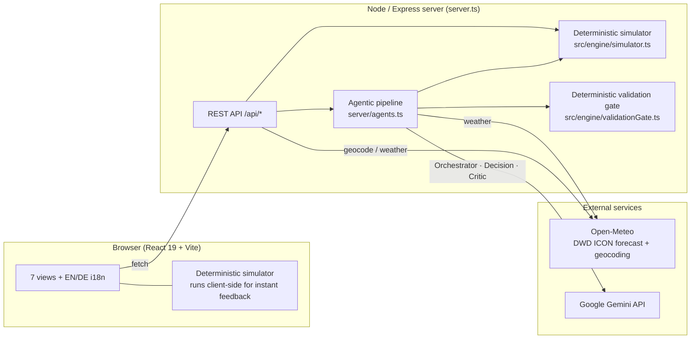
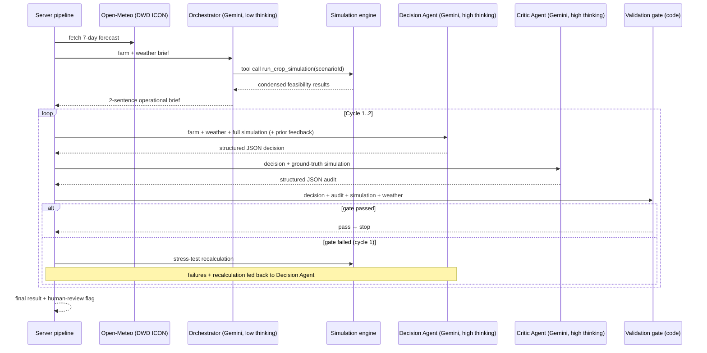

# AgroVera

**🌐 Live demo: [https://agrovera.ai.studio/](https://agrovera.ai.studio/)**

**Smarter Farming. Verified Decisions.**
**Intelligenter Anbau. Geprüfte Entscheidungen.**

AgroVera is a bilingual (English / Deutsch) crop decision-support platform for German arable farms. A farmer enters their field: location, soil, area, irrigation water, budget and planned sowing month. AgroVera then answers one question — *which of four German staple crops should I plant, and can I trust that answer?*

It combines four things:

1. A **deterministic TypeScript simulation engine** that scores Winter Wheat, Barley, Maize and Potato against hard constraints (sowing window, irrigation water in m³, budget in EUR, soil viability).
2. **Live weather** from the Deutscher Wetterdienst ICON model, served through the Open-Meteo API.
3. **Published reference data**: Destatis national yield averages, plus LTZ Augustenberg / LfL Bayern agronomic guidance.
4. A **server-side multi-agent pipeline** on Google Gemini. An Orchestrator calls the simulator as a tool, a Decision Agent writes the recommendation, and an independent Critic Agent audits it. A **deterministic validation gate** then has the final say, so an LLM can never push through a crop that the numbers rule out.

> Built for the **{Tech: Europe} Agentic AI Hack**.

---

## Table of contents

- [Why AgroVera](#why-agrovera)
- [Feature overview](#feature-overview)
- [Architecture at a glance](#architecture-at-a-glance)
- [Quick start](#quick-start)
- [Detailed setup & installation](#detailed-setup--installation)
- [Configuration](#configuration)
- [Available scripts](#available-scripts)
- [Using the app (demo walkthrough)](#using-the-app-demo-walkthrough)
- [Project structure](#project-structure)
- [Tech stack summary](#tech-stack-summary)
- [Testing](#testing)
- [Deployment](#deployment)
- [Troubleshooting](#troubleshooting)
- [Guide for the jury](#guide-for-the-jury)
- [Further documentation](#further-documentation)

---

## Why AgroVera

German farmers are seeing more 2018/2022-style droughts, heat waves above 35 °C, Starkregen (heavy rain) events and late frosts. Choosing what to plant is a trade-off between profit, climate risk, water availability (often capped by an irrigation permit) and working capital.

Generic chatbots answer that kind of question confidently, but they can invent yields, ignore a water permit, or recommend a crop that can't legally or physically be sown that month. AgroVera is designed around that failure mode:

- **The numbers never come from the LLM.** Every yield, cost, m³ figure and score is computed by deterministic code from documented inputs.
- **The LLMs only explain and audit.** They receive the simulation output and must stay faithful to it.
- **Code checks the LLMs.** A deterministic validation gate rejects any recommendation that breaks a hard constraint, regardless of what the agents say.
- **Every number is labelled by provenance**: *Verified Source*, *Illustrative Estimate* or *Missing / Not Connected*.
- **Uncertainty is surfaced, not hidden.** When weather or coordinates are missing, crops become `uncertain` rather than silently "feasible", and the pipeline flags the result for human review.

---

## Feature overview

| Area | What it does |
|---|---|
| **Farm Setup** | Enter location (live geocoding, German results first), soil type, area (ha), irrigation water (total m³ or mm/ha per season), budget (EUR/USD), sowing month, preferred crop and priority mode. Six German city presets and three ready-made demo farms. |
| **Climate Intelligence** | Live 7-day DWD ICON forecast (14-day global fallback outside Central Europe). Daily temperature and precipitation charts plus four risk indicators using DWD conventions: hot days (≥ 30 °C), frost days (≤ 0 °C), dry seedbed window (< 8 mm), Starkregen (≥ 25 mm/day). Thresholds are editable. |
| **Crop Simulator** | Deterministic evaluation of all 4 crops: seasonal suitability, water balance, input costs, yield/revenue/profit ranges, risk scores and a weighted suitability index. Updates instantly in the browser as inputs change. |
| **AI Decision Center** | Runs the full agentic pipeline. Shows the recommendation, trade-off analysis, alternative comparisons, assumptions, missing data, next steps, the Critic's audit checklist and objections, the validation-gate checks, and a step-by-step agent timeline. |
| **Scenario Analysis** | Five climate scenarios — Baseline, Drought, Heatwave, Heavy Rainfall, Late Frost — with editable multipliers. Compares results against the baseline and explains whether the recommendation shifted and why. |
| **Data Sources & Assumptions** | Transparency registry: every parameter with its source, URL, year and classification (verified / illustrative / missing). |
| **EN / DE switch** | Full UI localisation (353 keys, 100% parity between languages, checked by a test). AI agents answer in the selected language. Simulation numbers are identical in both languages. |

---

## Architecture at a glance



**The agentic loop** (at most 2 review cycles):



Full details: [`docs/ARCHITECTURE.md`](docs/ARCHITECTURE.md).

---

## Quick start

```bash
git clone https://github.com/megha-darda/agrovera.git
cd agrovera

# Option A (recommended) – Bun, uses the committed bun.lock
bun install

# Option B – npm (see "Installing with npm" below for why the extra flags are needed)
npm install --legacy-peer-deps && npm install react-is --legacy-peer-deps

cp .env.example .env          # then put your Gemini API key in .env
npm run dev                   # → http://localhost:3000
```

The deterministic simulator, weather and scenario features work **without** a Gemini key. Only the AI Decision Center needs one.

---

## Detailed setup & installation

### 1. Prerequisites

| Requirement | Version | Notes |
|---|---|---|
| **Node.js** | **22.18 or newer** (tested on 22.23) | Vite 8 needs Node ≥ 20.19 / 22.12. `npm start` runs `node server.ts` directly, which relies on Node's built-in TypeScript type stripping (on by default from 22.18). |
| **Bun** *(optional, recommended)* | 1.x (tested on 1.4.4) | Installs cleanly from `bun.lock`. |
| **npm** | 10+ | Works with the flags below. |
| **Gemini API key** | — | Needed only for the AI pipeline. Get one at [Google AI Studio](https://aistudio.google.com/apikey). |
| **Internet access** | — | The server calls `api.open-meteo.com`, `geocoding-api.open-meteo.com` and the Gemini API. No API key is needed for Open-Meteo. |

### 2. Clone

```bash
git clone https://github.com/megha-darda/agrovera.git
cd agrovera
```

### 3. Install dependencies

**With Bun (cleanest):**

```bash
bun install
```

**With npm:**

```bash
npm install --legacy-peer-deps
npm install react-is --legacy-peer-deps
```

> **Note:** with npm, both commands are needed. The first resolves a peer-dependency conflict between `esbuild` and Vite 8; the second installs `react-is`, which Recharts needs for the production build.

### 4. Configure environment

```bash
cp .env.example .env
```

Edit `.env`:

```env
GEMINI_API_KEY="your-real-gemini-key"
APP_URL="http://localhost:3000"
```

`.env` is git-ignored. The key is read **only on the server** and is never sent to the browser.

### 5. Run in development

```bash
npm run dev
```

This starts one Express server on **http://localhost:3000**. It serves the REST API and runs Vite in middleware mode, so the frontend gets hot reload. To use a different port: `PORT=4000 npm run dev`.

Check that it's running:

```bash
curl http://localhost:3000/api/config-status
# {"appName":"AgroVera","geminiKeyConfigured":true,"models":{...},"weatherSource":"Deutscher Wetterdienst (DWD ICON) via Open-Meteo API"}
```

### 6. Run the tests, type-check and build

```bash
npm test          # 10 acceptance tests (node:test via tsx); no network or API key needed
npm run lint      # tsc --noEmit
npm run build     # Vite production bundle → dist/
```

### 7. Run in production mode

```bash
npm run build
NODE_ENV=production npm start
```

> `NODE_ENV=production` matters. Without it, `server.ts` starts the Vite dev middleware instead of serving the built `dist/` folder.

---

## Configuration

### Environment variables

| Variable | Required | Default | Purpose |
|---|---|---|---|
| `GEMINI_API_KEY` | For AI features | — | Google Gemini key used by `server/agents.ts`. If it is missing or still the placeholder `MY_GEMINI_API_KEY`, the pipeline returns the deterministic results plus an `aiError` (no crash). |
| `PORT` | No | `3000` | HTTP port. |
| `NODE_ENV` | No | — | `production` serves `dist/` statically; anything else runs Vite middleware. |
| `APP_URL` | No | — | Hosting URL, injected by Google AI Studio / Cloud Run. Not read by the current code. |
| `DISABLE_HMR` | No | — | `true` disables Vite HMR and file watching (used by the AI Studio editor). |

### Model configuration

Model IDs are constants at the top of [`server/agents.ts`](server/agents.ts):

```ts
export const MODEL_ORCHESTRATOR   = 'gemini-4-hydrogen'; // thinkingLevel LOW, function calling
export const MODEL_DECISION_AGENT = 'gemini-4-carbon';   // thinkingLevel HIGH, JSON schema output
export const MODEL_CRITIC_AGENT   = 'gemini-4-carbon';   // thinkingLevel HIGH, JSON schema output
export const MAX_REVIEW_CYCLES    = 2;
```

If your key doesn't have access to these models, change the constants to models it does have. Nothing else needs to change. `GET /api/config-status` reports the active model IDs.

### Domain configuration

| What | Where |
|---|---|
| Crop parameters, sources, transparency registry | [`src/data/crops.json`](src/data/crops.json) |
| Climate scenarios, priority weights, weather thresholds, city and demo-farm presets | [`src/engine/presets.ts`](src/engine/presets.ts) |
| UI text (EN / DE) | [`src/i18n/locales/en.json`](src/i18n/locales/en.json), [`de.json`](src/i18n/locales/de.json) |

---

## Available scripts

| Script | Command | Description |
|---|---|---|
| `dev` | `tsx server.ts` | Full-stack dev server (Express + Vite middleware) on `PORT` (default 3000). |
| `build` | `vite build` | Production frontend bundle into `dist/`. |
| `start` | `node server.ts` | Starts the server. Use with `NODE_ENV=production` after building. |
| `preview` | `vite preview` | Static preview of `dist/` (frontend only — **no API**). |
| `test` | `npx --yes tsx --test src/engine/acceptance.test.ts` | Runs the 10 acceptance tests. |
| `lint` | `tsc --noEmit` | Type-checks the whole project. |
| `clean` | `rm -rf dist server.js` | Removes build output. |

---

## Using the app (demo walkthrough)

The app opens with the **default demo farm**: 12 ha of loamy soil in Karlsruhe (Baden-Württemberg), 19,200 m³ irrigation water, €42,000 budget, April sowing, *balanced* priorities. Potato, Maize and Spring Barley compete.

1. **Overview**: dashboard of the current recommendation, feasibility of all four crops, active constraints and a suitability-vs-risk chart.
2. **Farm Setup**: change any input, or load one of the other demo farms:
   - *Karlsruhe Autumn (October)*: 15 ha silty soil, 6,000 m³, €16,000. Winter Wheat vs Winter Barley.
   - *Brandenburg Sandy (March)*: 20 ha sand near Berlin, 8,000 m³, €22,000, *min climate risk*. Tests drought sensitivity and capital limits.
3. **Climate Intelligence**: fetch the live DWD ICON forecast for the farm coordinates and review the risk indicators. You can adjust the thresholds.
4. **Crop Simulator**: inspect each crop's water balance, costs, yield and profit ranges, risk scores and the reasons any crop is infeasible.
5. **AI Decision Center**: click *run* to start the agentic pipeline (typically 3–6 Gemini calls). Review the recommendation, the Critic's audit and the validation-gate checklist. The timeline shows every step, with durations.
6. **Scenario Analysis**: pick e.g. *Drought*, adjust the multipliers, re-run, and read how and why the recommendation changed relative to the baseline.
7. **Data Sources**: check where every number comes from.
8. Toggle **EN | DE** in the header at any point. The numbers stay the same, while the text and AI output switch language.

---

## Project structure

```
agrovera/
├── server.ts                    # Express entry: REST API + Vite middleware / static hosting
├── server/
│   └── agents.ts                # Gemini multi-agent pipeline (Orchestrator, Decision, Critic) + review loop
├── src/
│   ├── main.tsx                 # React entry
│   ├── App.tsx                  # App shell, state, navigation, evaluation cache, EN/DE switch
│   ├── index.css                # Tailwind v4 styles
│   ├── components/
│   │   ├── OverviewView.tsx             # Dashboard + Recharts bar chart
│   │   ├── FarmSetupView.tsx            # Farm inputs, geocoding, presets, crop reference table
│   │   ├── ClimateIntelligenceView.tsx  # Live forecast charts + risk indicators
│   │   ├── CropSimulatorView.tsx        # Per-crop deterministic results matrix
│   │   ├── DecisionCenterView.tsx       # AI recommendation, Critic audit, validation gate, timeline
│   │   ├── ScenarioAnalysisView.tsx     # Climate stress tests + baseline comparison
│   │   ├── DataSourcesView.tsx          # Provenance / transparency registry
│   │   └── AgroVeraLogo.tsx
│   ├── engine/
│   │   ├── simulator.ts         # Deterministic crop simulation + farm input validation
│   │   ├── weather.ts           # Open-Meteo DWD ICON fetch/parse + geocoding
│   │   ├── validationGate.ts    # Deterministic post-AI verification gate
│   │   ├── presets.ts           # Scenarios, weights, thresholds, city & demo presets
│   │   └── acceptance.test.ts   # 10 acceptance tests (node:test)
│   ├── data/crops.json          # Crop knowledge base + transparency registry
│   ├── types/domain.ts          # Shared TypeScript domain model (client + server)
│   ├── services/apiClient.ts    # Typed fetch wrappers for /api/*
│   ├── i18n/                    # i18next setup + en.json / de.json
│   ├── utils/formatters.ts      # Locale-aware number/currency/date/label formatting
│   └── assets/images/           # Hero image
├── public/favicon.svg
├── docs/                        # Technical documentation (see below)
├── index.html, vite.config.ts, tsconfig.json, package.json, bun.lock
├── metadata.json                # Google AI Studio applet metadata
└── .env.example
```

---

## Tech stack summary

| Layer | Technology |
|---|---|
| Language | TypeScript (strict types shared between client and server) |
| Frontend | React 19, Vite 8 (Rolldown), Tailwind CSS v4, Recharts 3, Motion, lucide-react |
| i18n | i18next + react-i18next (EN / DE, saved in `localStorage`) |
| Backend | Node.js 22, Express 4, dotenv, tsx |
| AI | Google Gen AI SDK (`@google/genai`): function calling, JSON schema structured output, thinking levels |
| Weather | Open-Meteo DWD ICON API + Open-Meteo Forecast API (fallback) + Open-Meteo Geocoding API |
| Data sources | Destatis harvest statistics, LTZ Augustenberg, LfL Bayern (see Data Sources view) |
| Testing | Node built-in `node:test` + `node:assert`, run via tsx |
| Tooling | Bun / npm, TypeScript compiler (`tsc --noEmit`) |
| Hosting target | Google AI Studio applet → Cloud Run (any Node host works) |

Full list with versions and roles: [`docs/TECH_STACK.md`](docs/TECH_STACK.md).

---

## Testing

```bash
npm test
```

The 10 acceptance tests in `src/engine/acceptance.test.ts` run offline. They inject a mock `fetch` and a mock AI adapter, so no network access or API key is needed.

| # | What is verified |
|---|---|
| 1 | German defaults: Karlsruhe, EUR, ha, m³, Europe/Berlin |
| 2 | Input validation catches bad fields and flags missing coordinates (EN + DE) without inventing values |
| 3 | DWD/Open-Meteo parsing and error handling never fabricate weather values |
| 4 | All 4 crop profiles and the provenance registry carry explicit classifications |
| 5 | Sowing-window, m³ irrigation and EUR budget hard constraints behave deterministically |
| 6 | Climate scenarios and custom overrides recalculate irrigation demand and rankings |
| 7 | EN ↔ DE switching has 100% locale-key parity and never changes numbers or rankings |
| 8 | Critic rejection → recalculation → Cycle 2 self-correction works in EN and DE |
| 9 | The 2-cycle limit holds, and the deterministic gate rejects independently of the Critic |
| 10 | No leftover legacy branding, and no `GEMINI_API_KEY` exposure in client code |

Current status: **10/10 passing**, `tsc --noEmit` clean, production build succeeds. Details: [`docs/TESTING_AND_QUALITY.md`](docs/TESTING_AND_QUALITY.md).

---

## Deployment

AgroVera is a single Node process, so it deploys anywhere Node 22 runs.

**Google AI Studio / Cloud Run** (the original target, per `metadata.json`): AI Studio injects `GEMINI_API_KEY` from its Secrets panel and `APP_URL` with the Cloud Run URL.

**Generic Node host / container:**

```bash
bun install            # or the npm commands above
npm run build
NODE_ENV=production PORT=8080 GEMINI_API_KEY=... npm start
```

The server listens on `0.0.0.0:$PORT`, serves the API under `/api/*`, and returns `dist/index.html` for every other route (SPA fallback).

---

## Troubleshooting

| Symptom | Cause / fix |
|---|---|
| `npm install` → `ERESOLVE could not resolve … esbuild` | Use `bun install`, or `npm install --legacy-peer-deps`. |
| `npm run build` → `failed to resolve import "react-is"` | Run `npm install react-is --legacy-peer-deps`. |
| Decision Center shows *"GEMINI_API_KEY is missing on the server"* | Add the key to `.env` and restart. Deterministic results are still shown. |
| AI error mentioning the model name (404 / permission) | Your key can't use the configured model IDs. Change the constants in `server/agents.ts`. |
| Weather shows *unavailable* / *fetch failed* | No outbound access to `api.open-meteo.com`, or invalid coordinates. Crops become `uncertain` instead of being faked as feasible. |
| `npm start` serves a dev build | Set `NODE_ENV=production` and run `npm run build` first. |
| `node server.ts` → syntax error on types | Node is older than 22.18. Upgrade, or use `npx tsx server.ts`. |
| Vite warning about `__dirname` in `vite.config.ts` | Harmless; the build completes normally. |

---

## Guide for the jury

To evaluate the project in about 10 minutes:

1. **Run it**: [Quick start](#quick-start), then open http://localhost:3000. Use the default demo farm.
2. **See the core idea**: open **AI Decision Center** and run the pipeline. Look at the *validation gate* checklist and the *agent timeline*.
3. **Stress it**: in **Scenario Analysis**, choose *Drought* and re-run. Read the scenario-shift explanation.
4. **Check honesty**: open **Data Sources** and look at the verified / illustrative / missing labels on every parameter.
5. **Read the code where it matters most**:
   - [`src/engine/validationGate.ts`](src/engine/validationGate.ts): how code overrides the LLMs.
   - [`server/agents.ts`](server/agents.ts): `executeAgenticPipeline()` loop, tool declaration, JSON schemas.
   - [`src/engine/simulator.ts`](src/engine/simulator.ts): the deterministic model.
6. **Run the tests**: `npm test` (offline, about 1 second).

What we believe sets AgroVera apart:
- **Deterministic ground truth + LLM explanation + LLM audit + code gate**. The final say belongs to code, not to a model.
- **A real tool-calling Orchestrator** that invokes the simulator through Gemini function calling.
- **A bounded self-correction loop**: failed checks trigger a stress-test recalculation and a second Decision cycle, capped at 2 to control cost and latency.
- **Graceful degradation**: missing key, failed model call or unavailable weather never crash the app, and never produce fabricated numbers.
- **Data provenance as a first-class feature**, plus full EN/DE localisation that is verified not to change any number.

---

## Further documentation

| Document | Contents |
|---|---|
| [`docs/ARCHITECTURE.md`](docs/ARCHITECTURE.md) | System design, data flow, agent pipeline, review loop, error handling, security |
| [`docs/API.md`](docs/API.md) | Every internal REST endpoint with request/response schemas and curl examples, plus the external APIs used |
| [`docs/SIMULATION_ENGINE.md`](docs/SIMULATION_ENGINE.md) | Formulas, crop parameters, scenarios, scoring and hard constraints |
| [`docs/TECH_STACK.md`](docs/TECH_STACK.md) | Every framework, library, API and tool, with version and purpose |
| [`docs/TESTING_AND_QUALITY.md`](docs/TESTING_AND_QUALITY.md) | Test suite, verification results, quality and safety measures |

---

*AgroVera is a decision-support prototype. It does not guarantee yields, prices or weather outcomes, and does not replace professional agronomic advice.*
