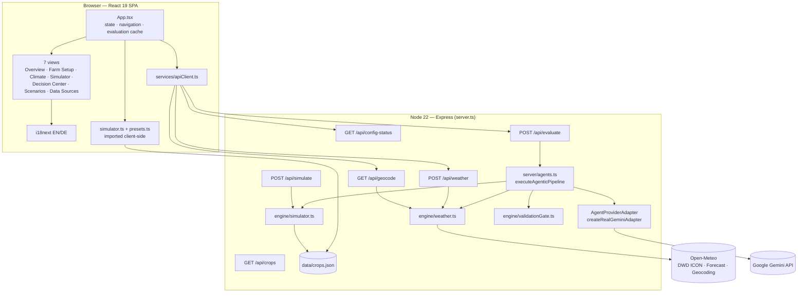
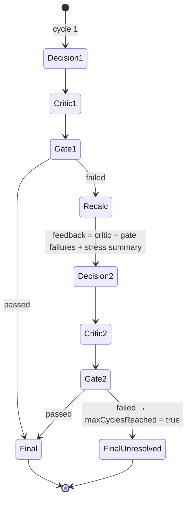

# AgroVera — System Architecture

This document describes how AgroVera is built: its components, how data moves between them, how the multi-agent pipeline works, and how failures and security are handled.

---

## 1. Design principles

| Principle | How it is enforced in code |
|---|---|
| **Numbers come from code, not from LLMs** | All yields, costs, m³ volumes and scores come from `simulateCrops()` in `src/engine/simulator.ts`. Agents receive this output as input. |
| **LLMs explain and audit; code decides validity** | `runDeterministicValidationGate()` runs after every Decision/Critic cycle and can fail a recommendation even when the Critic passed it. |
| **Hard constraints cannot be negotiated** | Sowing window, irrigation m³, budget and soil viability make a crop `infeasible` in the simulator. The gate rejects any infeasible recommendation. |
| **Provenance is explicit** | Every crop parameter and registry entry carries `classification: verified_source \| illustrative_estimate \| missing`. |
| **Missing data → uncertainty, not invention** | No coordinates or unavailable weather → crops become `uncertain`, and `requiresHumanReview = true`. |
| **Language never changes results** | The simulation is language-independent. Language only selects text fields and agent output language (test #7). |
| **Secrets stay server-side** | `GEMINI_API_KEY` is read only in `server/agents.ts` and `server.ts`. Test #10 scans client code for exposure. |
| **Bounded agent cost and latency** | `MAX_REVIEW_CYCLES = 2`, giving 3–6 Gemini calls per evaluation. |

---

## 2. Component overview



### 2.1 Shared engine (client and server)

`src/engine/*` and `src/types/domain.ts` are plain TypeScript with no browser or Node-specific APIs, so they run in both places:

- **In the browser**, `App.tsx` calls `simulateCrops()` inside a `useMemo`, so every input change updates the Simulator, Overview and Scenario views instantly with no network round-trip.
- **On the server**, the same function is the tool that the Gemini Orchestrator invokes, and it is the ground truth for the Decision Agent, the Critic and the validation gate.

Because the code is identical, the numbers a user sees in the Simulator are exactly the numbers the AI reasons over.

### 2.2 Server (`server.ts`)

A single Express app:
- parses JSON bodies (limit 1 MB);
- exposes six REST endpoints under `/api/*` (see [API.md](API.md));
- in development, mounts Vite in middleware mode (`appType: 'spa'`) so frontend and API share one origin and port;
- in production (`NODE_ENV=production`), serves `dist/` statically and falls back to `index.html` for client-side routes;
- listens on `0.0.0.0:${PORT || 3000}`.

### 2.3 Frontend (`src/`)

| File | Responsibility |
|---|---|
| `App.tsx` | Holds the global state (farm, scenario, overrides, weather thresholds, weather, evaluation cache, baseline snapshot, language), derives the live simulation, runs evaluations, and handles navigation and responsive layout. |
| `components/*View.tsx` | One view per navigation tab (see README feature table). Charts use Recharts (`LineChart`, `BarChart`). |
| `services/apiClient.ts` | Typed `fetch` wrappers: `fetchServerConfigStatus`, `searchLocations`, `fetchLiveWeatherForecast`, `runFullAgenticEvaluation`. |
| `i18n/index.ts` | i18next init. Language saved under `localStorage['agrovera_lang']`; also updates `<html lang>` and the document title. |
| `utils/formatters.ts` | Locale-aware formatting (`de-DE` / `en-US`) for numbers, currency, dates (Europe/Berlin), crop/soil/priority/risk labels; `deriveDashboardState()`. |

**Evaluation cache.** AI results are stored in memory under the key `${paramSignature}::${lang}`. If the user switches language, the Decision Center can show the cached result from the other language with a "stale language" banner instead of silently calling Gemini again. The first unmodified *baseline* evaluation is kept as a `baselineSnapshot`, which Scenario Analysis uses for comparisons.

---

## 3. End-to-end request flow (`POST /api/evaluate`)

`executeAgenticPipeline()` in `server/agents.ts` runs these stages. Each one appends an `AgentTimelineEvent` (stage, actor, model, status, bilingual title and summary, cycle, duration) that the Decision Center renders as a timeline.

| # | Stage (`timeline.stage`) | Actor | What happens |
|---|---|---|---|
| 0 | — | `server.ts` | `validateFarmProfile()`. Invalid input → HTTP 400 with bilingual messages. |
| 1 | `weather_request` / `weather_response` | Climate Risk Module | `fetchOpenMeteoWeather()` for the farm coordinates (skipped with an explicit *unavailable* result if they're missing). Parses daily series and computes 4 risk indicators. |
| 2 | `crop_profiles` | Crop knowledge loader | Records the 4 crop profiles and their Destatis references. |
| 3 | `orchestrator` | **Orchestrator** (`MODEL_ORCHESTRATOR`, thinking LOW) | Two-turn function-calling exchange: the model calls `run_crop_simulation(scenarioId)`, the server runs `simulateCrops()`, returns a condensed result, and the model writes a 2-sentence operational brief. |
| 4 | `simulation` | Deterministic engine | Records feasible-crop count and binding constraints for the active scenario. |
| 5 | `decision_agent` | **Decision Agent** (`MODEL_DECISION_AGENT`, thinking HIGH) | Receives farm, weather, the *full* simulation, the orchestrator brief, any prior-cycle feedback and any baseline comparison. Returns JSON that matches `decisionResponseSchema`. |
| 6 | `critic_agent` | **Critic Agent** (`MODEL_CRITIC_AGENT`, thinking HIGH) | Separate call with its own system prompt. Audits the decision against the ground-truth simulation on a 7-point checklist. Returns JSON that matches `criticResponseSchema`. |
| 7 | `validation_gate` | Deterministic gate | `runDeterministicValidationGate(decision, critic, simulation, weather)`; see §5. |
| 8 | `recalculation` *(only if the gate failed in cycle 1)* | Deterministic engine | Runs a stress-test simulation and feeds the result plus the gate failures back to the Decision Agent for cycle 2. |
| 9 | `final_recommendation` | Pipeline | Builds the final status, `requiresHumanReview`, `maxCyclesReached`, and the scenario-shift explanation. |

### 3.1 The Orchestrator's tool

```ts
{
  name: 'run_crop_simulation',
  description: 'Executes the deterministic TypeScript crop simulation engine for German crops ...',
  parameters: { type: OBJECT, properties: { scenarioId: { type: STRING } }, required: ['scenarioId'] }
}
```

The function response deliberately sends a **condensed** view to the lightweight model (per crop: suitability, feasibility, weighted score, required vs available m³, cost vs budget, risk level). The Decision Agent and Critic later receive the full `cropResults`. If the model doesn't call the tool, the server runs the simulation itself and records `toolInvoked: false`, so the pipeline never depends on the tool call happening.

### 3.2 Structured output contracts

Both reasoning agents use `responseMimeType: 'application/json'` with a `responseSchema`. Canonical IDs and enums (`recommendedCropId`, `decisionStatus`, `verdict`, `severity`, `category`, `targetScenarioId`) **must stay in English** even when the requested language is German. Only the human-readable fields are localised, so the code can always compare IDs reliably.

**Decision Agent output** (`DecisionAgentOutput`):
`recommendedCropId` (`winter_wheat|barley|maize|potato|none`), `decisionStatus` (`recommended|no_feasible_crop|uncertain_needs_data`), `headline`, `executiveSummary`, `tradeoffAnalysis{financial, climateAndEnvironmental, waterAndSoilResources}`, `alternativeComparisons[{cropId, comparisonSummary}]`, `keyAssumptions[]`, `missingInformation[]`, `actionableNextSteps[]`, `humanReviewNotice`, optional `scenarioShiftExplanation`.

**Critic Agent output** (`CriticAgentOutput`):
`verdict` (`pass|review|reject`), booleans `hardConstraintsSatisfied`, `alternativesComparedFairly`, `forecastUncertaintyCommunicated`, `numericalClaimsSupported`, `assumptionsConsistent`, `moreRobustAlternativeId`, `objections[{severity: critical|warning|note, category, detail}]`, `requestedRecalculation{needed, targetScenarioId, reason}`, `criticSummary`.

### 3.3 Prompting safeguards (system instructions)

The Decision Agent is told to:
1. never invent or alter simulation numbers, Destatis yields, m³, mm/ha, EUR or weather values;
2. never recommend an `infeasible` crop; if `feasibleCropsCount === 0`, return `none`;
3. distinguish verified inputs, the 7–14-day forecast, hypothetical scenarios and illustrative economics;
4. compare **all** non-selected crops;
5. never guarantee outcomes or recommend unverified chemical or pesticide treatments, and always advise human review (Offizialberatung / Landwirtschaftskammer);
6. keep fields concise.

The Critic is told to audit hard constraints, fairness, how forecast uncertainty is communicated, numerical fidelity, assumption consistency, missing information and climate robustness. It should neither invent rejections nor rubber-stamp real violations.

---

## 4. The review loop



**Choosing the recalculation scenario** (after a failure in cycle 1):
- if the Critic set `requestedRecalculation.needed = true` with a target other than `none` → use that scenario;
- otherwise → `drought` when the active scenario is `baseline`, else `baseline`.

The stress simulation runs without the user's custom override. Its summary (feasible count, top crop, ranking with scores) goes into `priorFeedback` for cycle 2, together with the Critic's output and the gate's failure reasons in the active language.

**Final flags:**
- `maxCyclesReached = reviewCycles.length >= 2 && !gate.passed`
- `requiresHumanReview = gate.requiresHumanReview || maxCyclesReached`

**Scenario-shift explanation.** If the client sent a `baselineComparison` and the Decision Agent didn't supply its own explanation, the server writes a deterministic one. Either the recommendation stayed stable, or it shifted because the previous crop became infeasible (quoting the reasons) or dropped in suitability (quoting the score).

---

## 5. Deterministic validation gate

`src/engine/validationGate.ts`. Each check produces a bilingual label and detail. Any failure sets `passed = false` and adds a failure reason.

| Code | When evaluated | Passes if |
|---|---|---|
| `NO_FEASIBLE_CONSISTENCY` | Decision = `none` | No crop is feasible **or** the farm input is invalid |
| `VALID_CANDIDATE_ID` | Decision names an unknown crop | *(always fails)* |
| `HARD_CONSTRAINT_FEASIBILITY` | Crop chosen | Chosen crop's status ≠ `infeasible` |
| `WATER_HARD_CONSTRAINT` | Crop chosen | `satisfiesWaterConstraint` (required m³ ≤ available m³ and no waterlogging) |
| `BUDGET_HARD_CONSTRAINT` | Crop chosen | Total input cost ≤ budget |
| `SEASONAL_PLANTING_WINDOW` | Crop chosen | Sowing month is `optimal` or `shoulder` |
| `PREFER_VERIFIED_FEASIBLE` | Chosen crop is `uncertain` while feasible crops exist | *(fails)* |
| `ALTERNATIVES_COMPARED` | Always | ≥ 3 alternatives compared (≥ 2 when the decision is `none`) |
| `UNCERTAINTY_AND_SAFETY_DISCLOSURE` | Always | ≥ 1 assumption, ≥ 1 missing-info item, human-review notice ≥ 12 characters |
| `INDEPENDENT_CRITIC_VERDICT` | Always | Critic verdict ≠ `reject` **and** `hardConstraintsSatisfied` **and** `numericalClaimsSupported` |

`requiresHumanReview` is true if the gate failed, the Critic said `review`, weather was unavailable, no crop is feasible, or the chosen crop is `uncertain`.

This makes the safety property hold **independently of both LLMs**. Even if the Decision Agent and Critic both agree on an infeasible crop, the gate fails it (covered by test #9).

---

## 6. Error handling and graceful degradation

| Failure | Behaviour |
|---|---|
| Invalid farm input | HTTP 400 with `validation.issues[]` (EN + DE). |
| Missing coordinates | Weather marked `unavailable`; crops `uncertain`; listed under missing information. |
| Open-Meteo HTTP error, timeout (9 s) or bad payload | `status: 'unavailable'` with a bilingual `errorMessage`. Never fabricated values. |
| Missing or placeholder `GEMINI_API_KEY` | The Orchestrator throws → the pipeline returns **HTTP 200** with the deterministic `simulation`, `decision: null`, `aiError{stage:'orchestrator'}` and `requiresHumanReview: true`. |
| Decision Agent error or invalid JSON | Returns everything gathered so far plus `aiError{stage:'decision_agent'}`. |
| Critic Agent error | Returns the decision (unverified) plus `aiError{stage:'critic_agent'}`, `requiresHumanReview: true`. |
| Gate still failing after 2 cycles | `maxCyclesReached: true`; final timeline event says "Verification unresolved — human review required". |
| Unexpected exception | HTTP 500 `{ error }`. |

The UI always has something useful to show, because the deterministic simulation is returned in every non-400 case.

---

## 7. Security and privacy

- **API key** is read only server-side (`process.env.GEMINI_API_KEY`). `/api/config-status` reports only whether a key is configured, never its value. Test #10 asserts that no client file references the key.
- **No user data is stored.** There is no database. Farm profiles exist in browser memory and in request bodies only.
- **Body size limit**: 1 MB JSON.
- **Outbound calls** go only to Open-Meteo (no key) and the Gemini API.

---

## 8. Extensibility

| To add… | Change |
|---|---|
| A new crop | Add an entry to `src/data/crops.json`, extend `CropId` in `domain.ts`, add labels in `agents.ts` (`localizedCropLabel`) and the locale files, and update the JSON schema descriptions. |
| A new climate scenario | Add it to `CLIMATE_SCENARIOS` in `presets.ts` and to `ClimateScenarioId`. |
| A different LLM provider | Implement the `AgentProviderAdapter` interface (`runOrchestratorWorkflow`, `runDecisionAgent`, `runCriticAgent`) and pass it as `adapter` to `executeAgenticPipeline()`. The tests already do this with a mock adapter. |
| A different weather source | Replace `fetchOpenMeteoWeather()`, keeping the `WeatherForecastAnalysis` shape. `fetchImpl` is injectable for testing. |
| A new language | Add `src/i18n/locales/<lang>.json`, extend `AppLanguage`, and add language directives in `agents.ts`. |
