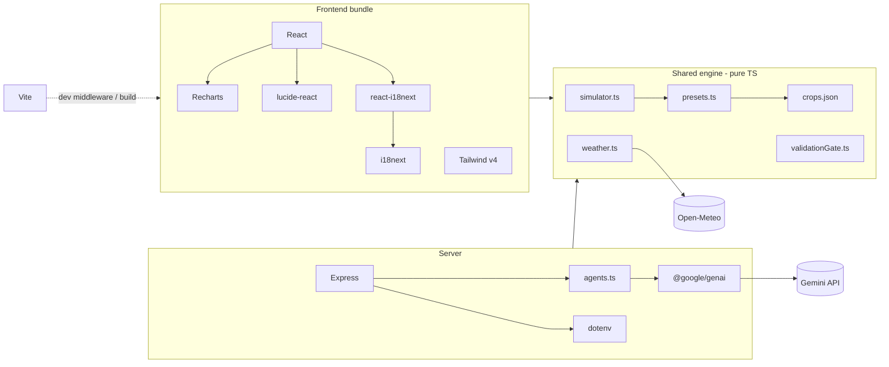

# AgroVera — Frameworks, Libraries, APIs & Tools

Every technology used in the project, what it does in AgroVera, and where it is used. Versions are those declared in `package.json` and resolved from `bun.lock` (checked on 14 Nov 2026).

---

## 1. Languages and runtime

| Technology | Version | Role in AgroVera |
|---|---|---|
| **TypeScript** | 7.0.2 (`^7.0.2`) | The whole codebase: frontend, backend and engine. One domain model (`src/types/domain.ts`) is shared by client and server. Type-checked with `tsc --noEmit`. |
| **Node.js** | ≥ 22.18 (tested 22.23) | Server runtime. `npm start` runs `server.ts` through Node's native TypeScript type stripping. |
| **JSON** | — | Crop knowledge base (`src/data/crops.json`) and locale files, imported with `with { type: 'json' }` import attributes. |

## 2. Frontend

| Library | Version | Role | Where |
|---|---|---|---|
| **React** | 19.3 | UI component framework | `src/App.tsx`, `src/components/*` |
| **React DOM** | 19.3 | Browser rendering | `src/main.tsx` |
| **Vite** | 8.3 (Rolldown bundler 1.2) | Dev server with HMR (middleware mode inside Express) and production bundler | `vite.config.ts`, `server.ts` |
| **@vitejs/plugin-react** | 6.3 | JSX transform and React Fast Refresh | `vite.config.ts` |
| **Tailwind CSS** | 4.3 | Utility-first styling; v4 CSS-first config | `src/index.css`, all components |
| **@tailwindcss/vite** | 4.3 | Tailwind integration for Vite | `vite.config.ts` |
| **Recharts** | 3.10 | Charts: daily temperature/precipitation `LineChart`/`BarChart` (Climate), suitability-vs-risk `BarChart` (Overview) | `ClimateIntelligenceView.tsx`, `OverviewView.tsx` |
| **react-is** | 19.3 | Peer dependency of Recharts  | transitive |
| **lucide-react** | 0.546 | Icon set | all views |
| **Motion** | 12.x | Animation library (declared dependency) | — |
| **Google Fonts** | — | Plus Jakarta Sans (headings), Public Sans (body), JetBrains Mono (numbers) | `index.html` |

## 3. Internationalisation

| Library | Version | Role |
|---|---|---|
| **i18next** | 27.1 | Translation engine; `en` and `de` resources; fallback `en` |
| **react-i18next** | 18.0 | `useTranslation()` hook in components |
| Locale files | 353 keys each | `src/i18n/locales/en.json`, `de.json`; 100 % key parity enforced by test #7 |

Language is stored in `localStorage['agrovera_lang']`, and switching it also updates `<html lang>` and the page title. The server-side agents get a `language` parameter and write their human-readable output in that language.

## 4. Backend

| Library | Version | Role | Where |
|---|---|---|---|
| **Express** | 4.22 (`^4.21.2`) | HTTP server, JSON body parsing, REST routes, static hosting, SPA fallback | `server.ts` |
| **dotenv** | 17.4 | Loads `.env` (`GEMINI_API_KEY`, `PORT`) | `server.ts` (`import 'dotenv/config'`) |
| **tsx** | 4.23 | Runs TypeScript directly in development (`npm run dev`) and for tests | `package.json` scripts |
| Native `fetch` / `AbortController` | Node 22 built-ins | Calls to Open-Meteo with a 9 s timeout | `src/engine/weather.ts` |

## 5. Artificial intelligence

| Technology | Version | Role |
|---|---|---|
| **Google Gen AI SDK** (`@google/genai`) | 3.3.0 | Official Gemini client: `GoogleGenAI`, `models.generateContent`, `Type`, `ThinkingLevel`, `FunctionDeclaration` |
| **Gemini API** | — | Hosts the three agents |

Gemini features used:

| Feature | Used for |
|---|---|
| **Function calling** (`tools.functionDeclarations` + `functionResponse`) | Orchestrator invokes `run_crop_simulation(scenarioId)`, which runs the deterministic engine on the server |
| **Structured output** (`responseMimeType: 'application/json'`, `responseSchema`) | Decision and Critic agents return strictly typed JSON |
| **System instructions** | Role definitions, safety rules, audit checklist, language directives |
| **Thinking levels** | `LOW` for the lightweight Orchestrator, `HIGH` for the Decision and Critic agents |

Agent roles:

| Agent | Model constant | Default model ID | Thinking | Output |
|---|---|---|---|---|
| Orchestrator | `MODEL_ORCHESTRATOR` | `gemini-4-hydrogen` | LOW | Tool call + 2-sentence brief |
| Decision Agent | `MODEL_DECISION_AGENT` | `gemini-4-carbon` | HIGH | `DecisionAgentOutput` JSON |
| Critic Agent | `MODEL_CRITIC_AGENT` | `gemini-4-carbon` | HIGH | `CriticAgentOutput` JSON |

The pipeline goes through an `AgentProviderAdapter` interface, so another LLM provider (or a test mock) can be plugged in without touching the orchestration logic.

## 6. External data APIs

| API | Endpoint | Auth | Role |
|---|---|---|---|
| **Open-Meteo DWD ICON API** | `api.open-meteo.com/v1/dwd-icon` | none | 7-day forecast from the Deutscher Wetterdienst ICON model (Central Europe) |
| **Open-Meteo Forecast API** | `api.open-meteo.com/v1/forecast` | none | 14-day global fallback outside the DWD domain |
| **Open-Meteo Geocoding API** | `geocoding-api.open-meteo.com/v1/search` | none | Location search, German results first |

Variables requested: `temperature_2m_max`, `temperature_2m_min`, `precipitation_sum`, `et0_fao_evapotranspiration` (FAO-56 reference evapotranspiration).

## 7. Reference data (static)

| Source | Used for |
|---|---|
| **Statistisches Bundesamt (Destatis)**, harvest statistics 2024–2025 | National average yields (verified) |
| **LTZ Augustenberg** (Baden-Württemberg) | Sowing windows, cultivation guidance |
| **LfL Bayern** (Deckungsbeiträge) / KTBL / BLE categories | Structure for illustrative cost and price estimates |
| **DWD** conventions | Hot day ≥ 30 °C, frost day ≤ 0 °C, Starkregen ≥ 25 mm/24 h |

## 8. Testing and quality

| Tool | Role |
|---|---|
| **node:test** + **node:assert/strict** (Node built-ins) | Test runner and assertions for the 10 acceptance tests |
| **tsx --test** | Runs the TypeScript test file without a compile step |
| Mock `fetch` / mock `AgentProviderAdapter` | Offline, deterministic tests of weather parsing and the agent loop |
| **TypeScript compiler** (`tsc --noEmit`) | Static type checking (`npm run lint`) |

## 9. Build, package management and hosting

| Tool | Role |
|---|---|
| **Bun** 1.x | Recommended package manager (`bun.lock` committed) |
| **npm** 10+ | Alternative (install commands in README) |
| **esbuild** 0.25 | Declared dev dependency |
| **autoprefixer** 10.x | Declared dev dependency |
| **Google AI Studio** | Development and hosting environment (`metadata.json`, `MAJOR_CAPABILITY_SERVER_SIDE_GEMINI_API`, the `DISABLE_HMR` switch) |
| **Google Cloud Run** | Production hosting target (server binds `0.0.0.0:$PORT`) |
| **Git / GitHub** | Version control |

## 10. Dependency map

